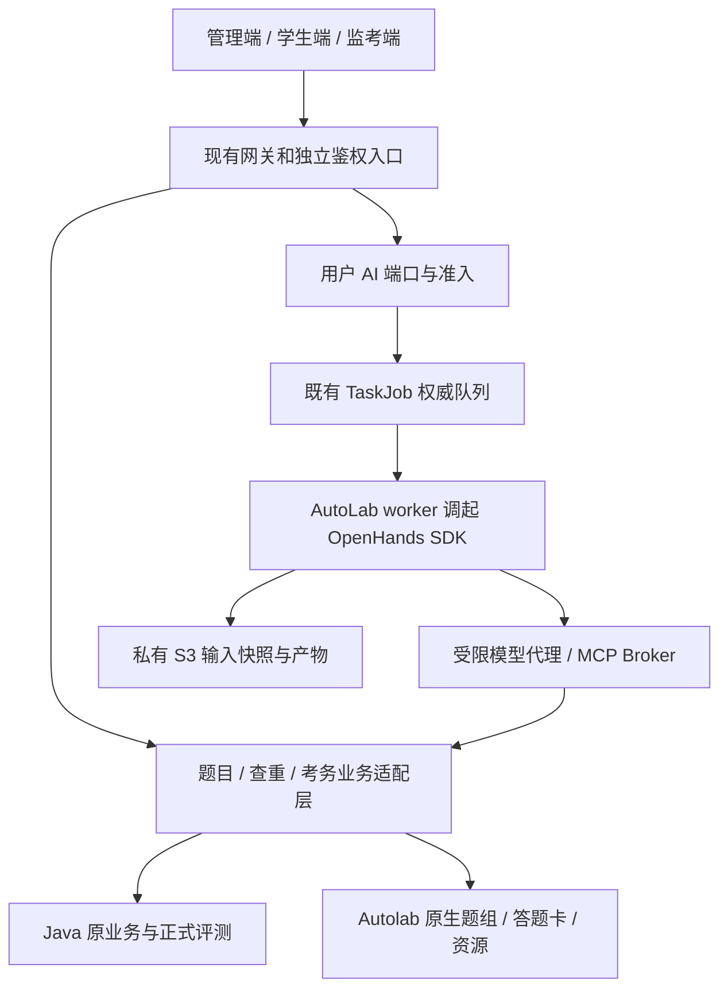

# SDUOJ 平台 v2：设计与实施总纲

> 2026-10-18 审计修订。本文是**开发方案，不是上线授权或生产现状证明**。SQL、鉴权、网关、密钥和沙箱变更需另行审查批准；本轮只改文档。
> 最新架构决策先读 [10 OpenHands 与组件](10-OpenHands与Agent组件.md)，再读[审计与实施门禁](09-审计与实施门禁.md)及[任务清单](task-list.yaml)。
> 当前实施范围、48 项逐项状态和出题/查重/考务后续批次见 [31 全平台进度](31-全平台进度与后续批次.md)。

## 1. 范围与需求映射

| 系统 | 目标 | 保留的原流程 |
| --- | --- | --- |
| [01 云 Agent](01-云Agent系统.md) | OpenHands SDK、AutoLab Task worker、受限工具、工作区和版本管理 | TaskJob 租约/心跳与模型计费代理；旧 Codex 路径分组件迁移 |
| [02 AI 端口与 MCP](02-AI端口与MCP.md) | 用户自建 Responses 端口、单一默认、并发与预算、受限 MCP 工具 | 当前账户准入、AiRun/AiLedger、人工审批、旧批阅兼容入口 |
| [03 出题平台](03-出题平台.md) | 三题型统一检索、权限投影、九阶段出题、解析/翻译、七项终检和真人实测 | Java 判题/正式提交、Autolab 原生题组和答题卡，不合并原始存储 |
| [04 查重](04-查重系统.md) | 扫描与发布分离、批量、复查、阈值调整、导出和本人结果 | 原快照与 JPlag 执行、教师决策、确定性非 AI 路径 |
| [05 考务](05-考务系统.md) | 账号台账、导入恢复、密码材料、受限监考会话 | 原 exam.prepare/publish、TEST/FORMAL 门禁、考场和座位规则 |

2026-10-19 用户确认按现有 48 项开发任务推进，以各项 acceptance 作为本目标验收基线，不再以缺失的原始 35 条正文阻塞。保留 48 个任务 ID、依赖、仓库归属、审批门禁及反例验收；原稿的“35/35 关键词覆盖”仍不作为业务证据。

## 2. 源码基线与事实等级

原稿来自较早的 `sduoj-dev` 工作副本。审计另核对已整理分支：Autolab `e3b55c5`、server `085bb7cc`、web2 `2215a75`、deploy `d51b7f6`。这些是本地源码证据，**本轮没有登录生产或核验当前部署 digest**。旧工作副本还含未提交代码，不能只用其 HEAD 代表所读内容。

| 原结论 | 审计后结论 | 任务 |
| --- | --- | --- |
| management-agent 未受 peer 校验 | 旧副本存在缺口；整理基线已覆盖 `/auto-task`、`/management-agent`、`/question-bank`，保留回归而非重写 | S1-01 |
| 任意登录用户可按 pid 读答案 | 表述过强。Depends 已校验 gid 管理权限；真正缺口是没有验证 gid/type/pid 关联，info 与 edit 都需核查 | S1-02 |
| 智能管理只有进程内 RUNTIMES | 旧实现；整理基线已有 AiResource + TaskJob、租约、跨 Web worker 确认与 AiRun 结算 | S2-06、S3-01 |
| Internal Controller 无 @Auth 即无保护 | 有 Internal RPC 拦截器，是否有效取决于启用开关和部署配置，不能只看方法注解判定漏洞 | S1-01 |
| 编程题四档可见性已经完全正确 | 基本入口已存在，但缓存撤权、hashCode 键碰撞与多管理组语义仍需验收 | S1-04 |

完整证据链和原稿勘误见 [09](09-审计与实施门禁.md)。事实标记分为：`source_confirmed`（静态确认）、`regression_evidence`（有隔离回归）、`hypothesis`（待证明）、`design_proposal`（新方案）。不把静态发现写成生产利用结论。

## 3. 分层与权威数据

- 01 负责 AutoLab worker 的 OpenHands 执行适配；02 负责端口、授权、额度和工具代理；03–05 负责业务规则；10 定义组件注册、M 端开关和前端发现。新增 AI 逻辑在 AutoLab，Java 优先复用既有接口。
- 题目索引是可重建投影，不能替代源系统鉴权。不能由 Autolab 直写 Java 库，不新增跨库外键或事务。
- 只读列表也有答案、私有代码和考生信息泄露风险。公开题面、作者管理详情、考试作答详情必须分开投影。
- 业务操作保留确定性入口。查重、渲染、非 AI 文档解析不应因为没有模型端口而不可用。

## 4. 共用契约

### 4.1 身份、授权和凭据

浏览器沿用既有 SESSION；内部 RPC 沿用原认证链并验证实际开关。Agent 不得持有浏览器 Cookie、内部 RPC token、用户 provider key 或 S3 长期密钥，只获得短期、限工具和限资源的作业能力令牌。

`owner_id` 不是用户会话，也不能据此自行构造 `SDUOJUserInfo`。默认保留原模式：敏感写操作由本人在当前有效浏览器会话确认，Cookie 仅用于当次调用，不持久化。后台自动 MCP 调用需经单独授权设计，令牌需绑定 subject、job、audience、scope、lease、有效期和可撤销授权；执行时重新验证本人和当前权限。未实现前不得开放“以用户身份全自动写入”。

### 4.2 端口与计费

v2 默认不提供隐式站点兜底：显式选中的本人有效端口 → 本人有效默认端口 → `503 port_not_configured`。显式端口不存在、被禁用或无权限时失败，不能悄悄换端口。旧站点 provider 仅服务既有兼容路径；迁移需显式选择、费用确认和开关。

作业入队时固定端口 ID/配置版本、模型、harness、价格和输入快照。每个模型请求复用既有预留、结算和未结算冻结规则。预算字段和并发字段本身不构成额度控制。

### 4.3 ID 与枚举

API 的 Java Long ID 一律用十进制字符串；原正式提交 hex ID 保留原格式。统一题目 `uid=prog:<id>|obj:<id>|subj:<id>`，类型用字符串 `program|objective|subjective`；不得把它强转成现有 `problem_group.type`。原枚举为 `0=objective, 1=subjective, 2=program`。

题单学生路径是个人显示下标，管理路径是 native 主键；必须经过原映射函数解析，不能重命名字段后直接复用数值。

### 4.4 HTTP、错误与前端

- 保持项目 GET/POST 约束；原稿 DELETE 解绑改成 POST。以 [07](07-API清单.md) 为接口路径唯一清单。
- 成功 `code=0`，主字段为 `message`；旧 `msg` 兼容由 request.ts 处理，不新建第三种包体。HTTP 状态与业务错误语义同时测试。
- 端口并发满保持任务排队；只有创建被拒/请求过频才返回 429。`blocked` 是可观察状态，不等于自动重试所有错误。
- 所有写操作带幂等键；修改既有对象时带 expected_version，创建无既有版本时只需 key，详见 07。不确定外部结果进入待对账，不能重试写操作来猜结果。
- 新用户端口页不放在 ADMIN 专用管理布局；新统一题目路由不占用原 `/problem/:ProblemCode`。双语、路由守卫和请求封装沿用原项目。

## 5. 实施顺序与放行

| 路径 | 前置条件 | 可独立推进 |
| --- | --- | --- |
| 基线与安全回归 | 冻结真实源码；对象绑定及缓存撤权评审 | 是 |
| OpenHands/用户端口 | 无隐式兜底；默认唯一、预算、SSRF、队列并发 | 是；固定 SDK/端点合同，旧多 Harness 路线退出一期 |
| worker/工作区 | 原租约 fencing、SDK 版本契约、执行 profile 和存储 PoC | 是；公开多租户在隔离验收前关闭 |
| 题库/出题 | 源 ACL、多组迁移、ID 映射与发布幂等 | 是；混合题组单独放行 |
| 查重 | 不可变快照、完整度、人工复查与隐私发布 | 是，不依赖模型解释 |
| 考务 | 台账、非覆盖导入、材料校验、链接作用域 | 是；新免密入口需单独鉴权批准 |

依赖 DAG 以 task-list.yaml 为准，阶段不是一条强制串行大队列。每个 PR 只含一个目的；保持原 Gradle/Maven 包发布、judging-containers 与目录发布流程，不为了 v2 改造供应链。

## 6. 文档与校验

[10](10-OpenHands与Agent组件.md) 和 [组件目录](agent-components.yaml) 明确最新执行/组件路线；01–05 定义领域行为，[06](06-数据库变更汇总.md) 独占 DDL 草案，[07](07-API清单.md) 定义接口，[08](08-前端改造方案.md) 定义前端实施，[09](09-审计与实施门禁.md) 保留证据与阻断条件。

运行 `python3 docs/platform-v2/validate_plan.py` 检查 48 项任务、引用、依赖无环、审批门禁、文档链接、DDL 数量与安全默认值。该校验**不执行 SQL、不验证真实 MySQL 锁、不替代业务或生产验收**。
