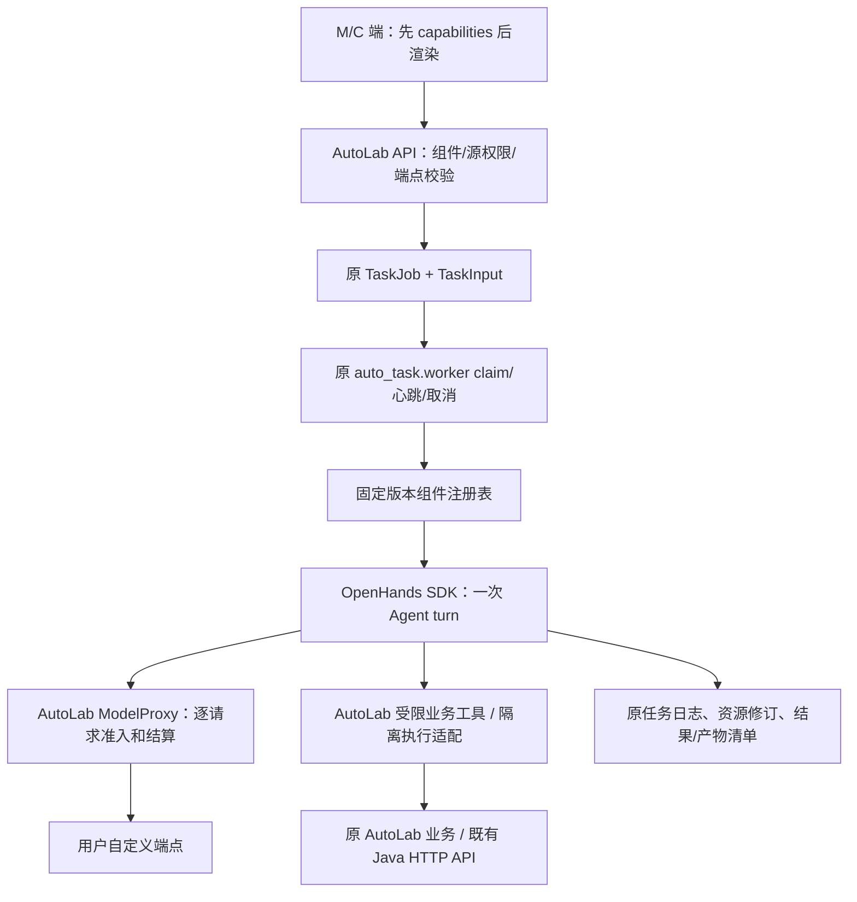

# 10 OpenHands、AutoLab Task worker 与 Agent 组件

> 2026-10-18 用户决策：OpenHands 作为 Agent 引擎；AI 业务、端点、组件治理和执行适配落在 AutoLab；复用 Task worker；调用用户端点；M 端管理组件开关，前端发现能力后渲染。本文件取代早稿中“新建多 Harness/独立节点控制平台”的一期路线。这里是待实现合同，不表示 SDK 已接入或开关已生效。

## 1. 职责与执行位置

采用 **OpenHands Software Agent SDK**，SDUOJ 使用自己的前端和任务系统。Agent Canvas、OpenHands 自动化调度和独立用户系统不作为一期依赖。



- Agent 由领取该任务的 **Task worker 进程**调起。Web 请求只建任务/读状态；不运行模型循环，也不在每个 Web worker 常驻一个 Agent。
- 原 Task worker 是调用与生命周期的唯一 owner；SDK 在 **worker 启动/监控的独立解释器 runner 子进程**中运行。已读 SDK 要 Python >=3.12/Pydantic >=2.13.5，现 AutoLab 固定 Pydantic 1.10.2/FastAPI 0.86；不在原解释器直接 import，也不顺带全栈升级。runner/协议代码仍归 AutoLab，发布依赖按原流程另实施。
- `business_tools` profile 的 runner 只装 SDK 和登记的窄工具客户端，无通用 Terminal/FileEditor、任意 SQL/HTTP 或宿主文件工具。禁用宿主 HOME 配置、自动加载 skills/MCP/plugins 和 provider 凭据发现；以环境白名单启动，不继承其它端点密钥或 SDK fallback。用有界 schema JSON IPC 向 worker 请求工具/事件；worker 原权限 dispatcher 执行已登记动作。不要反序列化 pickle 或接受客户端 import path。模型输出只成为经校验的数据。question.assistant 的普通 verify 只做静态建议；旧 allow_execution=true 必须显式映射 verify_execute 和 sandbox_tools，未安装/未放行执行工具时 unavailable，不能静默忽略执行或在宿主运行。
- 需要 shell/编译的 `sandbox_tools` profile，由 worker 管理隔离工作区；工具不能在 worker 宿主直接执行不可信代码。若选定 SDK 的 RemoteConversation 要求沙箱内 Agent Server，它只是该任务的受控执行进程，不是第二套业务 API、队列或用户系统。两种 profile 的实际执行位置须有 PoC 证据。sandbox_tools 还必须满足既有 AUTOLAB_SANDBOX_ENABLED 部署许可及原执行器限制；关闭时相关执行 action unavailable，M 组件开关不能覆盖。确定性 JPlag/AutoLab ide.execute 保留自己的原 sandbox flag，Java Run 保留原判题/Run 链，不以 Agent 开关替代。
- 全部新增平台逻辑在 AutoLab。正式提交、判题、Java 数据权威继续走原业务链。没有安全可用的既有 Java API 时先禁用对应动作/返回 unavailable，列出最小接口缺口；不直连 Java 数据库、不伪造用户头或重用超管 token。
- S1-04 等已确认的既有 Java 安全修复仍单独处理；“减少 Java 改动”不意味着忽略已有权限问题。

## 2. 一次使用与异步任务

一期定义：**一次用户操作/一次对话输入 turn = 一个 TaskJob**，不是整个长会话永远占一个 worker。

1. API 验证组件和 action、当前主体/资源权限、operation_key、输入版本及显式/默认端点；冻结 component/version、action、OpenHands release、port/version、模型/价格和输入 hash。
2. 写原 TaskJob/TaskInput，返回 taskId。新的统一入口用 `agent.run`；旧 task_type 和旧 API 保留，由固定映射分批转入相同 dispatcher。组件治理生效时所有旧 AI 入口必须先接入同一 gate；尚未适配的 action 标 unavailable，不保留可绕过治理的 legacy 模型路径。
3. worker 领取时重新检查组件、依赖、权限和端点，构造 OpenHands Agent/Conversation 与本组件允许的工具。一个 turn 的多轮模型调用/子 Agent 仍属于同一任务预算；OpenHands 的 task tracker 不等于新的 TaskJob 队列。
4. runner 的 JSON IPC 事件关联 task/attempt/sequence；worker 校验来源、长度和 schema，写原日志；每次模型/工具准入重新核验开关、权限和 lease。取消/租约丢失终止后续调用和所拥有的子进程，不接受旧 worker 迟到写入。
5. 输出通过组件 schema、产物 hash 和原 fenced complete 后才可见。用量未知进入 unsettled；外部动作未知进入 unknown/对账，不通用重试。

session_id 指原 AiResource 会话；SDK conversation/checkpoint 是其执行状态，不复制第二份可变业务正文。同会话不能并行修改；下一次用户输入建立下一 TaskJob，并验证上一版本/checkpoint 是否可读。不能用重放整个提示词冒充恢复。

### 2.1 人工确认不占用 worker 等待

一期使用受限 `propose_action` 工具生成候选并结束当前 turn：任务可 success，结果 `stop_reason=requires_confirmation`，资源标 pending_confirmation。浏览器使用当前有效本人会话调用经适配的确认入口；Cookie 只用于这次 HTTP 请求，不进入 Task payload、SDK 状态或 checkpoint。

**这是要实现的状态适配，不是原接口开箱支持。** reviewed `management_agent.decide` 要求 active TaskJob=running，`run_turn` finally 会使 pending 动作过期；因此不能直接将 success 的新任务送到旧 decide。保留旧 turn 行为直至迁移，新增候选状态独立于活跃 worker lease：保存 task_id/attempt、主体、component/action/generation_tuple、resource/expected_version、action_id/hash、有效期与 pending/approved/executing/completed/rejected/expired/unknown。只允许成功并 fenced 登记的候选成为待确认项，生成失败或旧 lease 不留可执行候选。

确认时验证当前会话/原资源权限/组件 generation/有效期和资源版本，并以版本 CAS 将 pending→executing（拒绝则 rejected）；同一动作重复确认读 receipt，绝不重复发请求。审批不沿用已结束的 worker lease。动作执行复用原 allowlist 与 native-plan/finalize 等业务规则，新增 current-browser 授权适配；外部 timeout→unknown、先对账。另一个新 turn/编辑/撤权/关闭会使旧候选失效，不能重新拼 SDUOJUserInfo 或拿短期 runner token 执行业务写。

确认后保存 action receipt，需要继续时再建一个 turn。这里不声称 SDK 原生暂停工具已被完整迁移；若将来采用原生 HITL，另验收 worker 释放、权限重检和恢复协议。关闭组件后，旧候选不能继续执行。

## 3. 用户端点与 OpenHands

端点模型和预算沿 [02](02-AI端口与MCP.md)。选择顺序：明确指定的本人有效端点，否则本人有效默认；无默认返回 port_not_configured。显式错误不回退到其它端点或站点 provider。

SDK 连接 **AutoLab 代理地址 + 当前任务短期 token**，真实用户 key 留在代理侧。代理按冻结 port/version 转发到用户端点。生成、审校、上下文压缩、子 Agent、SDK 自重试都不得绕过这一路径或另用默认云端。

已核对 [SDK LLM 源码](https://github.com/OpenHands/software-agent-sdk/blob/59b2831c17fbd6793f1cb8103d3fd91e57420324/openhands-sdk/openhands/sdk/llm/llm.py)：存在 base_url 与显式 api_mode=responses/chat/auto。它只证明有配置入口；不证明所有“OpenAI 兼容”端点都能运行相同工具协议。一期保留 Responses 合同，用固定 SDK + 假模型检验工具调用、结构化结果、stream/usage、取消与失败；模型别名不依赖 auto 猜测。Chat Completions 是单独适配能力，未通过时明确不支持。

组件只能声明所需能力，例如 tools/vision/structured_output；不能指定任意 URL、key、备用模型或无限迭代。能力不足在发送前拒绝，未知价格 blocked。管理端控制功能，不代替用户选择模型端点。

## 4. 可插拔组件目录

机器清单是 [agent-components.yaml](agent-components.yaml)。14 个业务组件全部仍需 OpenHands 迁移/实现；“已有基础”只指旧处理链。组件 ID、action、工具及迁移绑定必须与清单一致。

| 组件 ID | 功能 / action | 当前基础与边界 | 建议批次 |
| --- | --- | --- | --- |
| content.review | 输入/资料内容审核（内部组件） | 旧 moderation 横跨 extraction/index/authoring；禁用不等于内容已审核 | 1 |
| management.assistant | 管理问答、操作计划 | management.turn；执行仍走本人确认 | 1 |
| document.extract | 文档/图片识题、题块结构化 | question.extract；保留确定性文件提取，不能隐式依赖翻译 | 2 |
| document.translate | 题面/选项/解析翻译 | 旧提取中有双语输出，需拆成独立版本化 action | 2 |
| question.assistant | 解答、核验、追问；verify 的受控执行为独立 verify_execute action | question.solve/verify/chat；作者权限与学生辅导分开 | 2 |
| authoring.programming | 编程题题面、标程、数据/validator/checker 草稿、审校建议 | authoring.generate；执行验证是隔离工具，发布另确认 | 2 |
| authoring.objective | 客观题草稿、答案/干扰项与审校 | 原 native authoring 规则；不自动公开答案 | 2 |
| authoring.subjective | 主观题草稿、rubric、参考解与审校 | 原 native authoring 规则，保留正式题版本 | 2 |
| grading.subjective | 主观题评分建议、反馈 | subjective.grade / subjective_review；原 AiReview 和教师采用保留 | 1 |
| plagiarism.explain | 配对解释、证据整理 | plagiarism.scan/code_similarity 的可选 AI 段；JPlag 扫描不依赖此开关 | 3 |
| ide.tutor | 提示、讲解、错误诊断 | ide.tutor；考试禁用策略与隐藏测试数据边界保留 | 3 |
| course.assistant | 基于课程资料问答、引用 | course.ask；索引/资料 ACL 和版本核验独立 | 3 |
| interview.assistant | AI 面试提问、追问、报告建议 | interview.advance；本人/教师权限、限时/轮数和教师采用保留 | 3 |
| exam.assistant | 组卷/考务方案建议 | 新 AI 组件；原 exam.plan 是确定性流程，不因此改成 AI | 3 |

批次不是线上启用承诺。每个组件及其 action 独立开关；默认关闭的新组件只有安装、合同测试、权限和预算验证通过后才可启用。

### 4.1 组件接口（拟实施，不是现有包）

```python
class AgentComponent:
    manifest: ComponentManifest
    def validate_input(self, actor, action, source): ...
    def resolve_context(self, actor, source_version): ...
    def build_agent(self, proxy_llm, approved_tools): ...
    def validate_output(self, output, input_manifest): ...
    def prepare_result(self, output): ...  # 原 fenced transaction 内发布候选
```

manifest 至少含 id/version、input/output schema、actions、允许工具、资源种类、所需模型能力、执行 profile、预算/迭代/时间上限、旧任务绑定、前端入口和历史读取策略。每次只能从服务端静态注册表加载；未知 ID/版本拒绝。M 端不能上传 Python/任意 import path、安装市场插件、任意 MCP 或放开 shell。组件升级保留在途任务的旧版本；未排空不能卸载。

工具、技能和业务组件不是同一层：组件组合工具/提示词/校验；OpenHands Skill 不获得业务权限，LLM 返回的组件名或 tools 参数不能扩权。工具集合必须按当前 action/profile 投影，组件级 tools 仅是上限；execution.validate_bounded 只在已启用且放行的 verify_execute 或编程题 solution/tests/validator/checker action 下可用，服务端 dispatcher 再核对 action/profile，不能由 chat/verify/statement/review 调用或以参数切换。跨组件调用也检查被调用组件/action 开关，不能借 management 绕过 grading 或 authoring 的禁用。

### 4.2 不应被 Agent 开关关闭的能力

正式提交、Run、云保存、JPlag 确定性扫描、题库普通检索/手动编辑、非 AI 文件提取/索引阶段、考场座位/账号台账/材料/监考、任务历史/取消/对账继续按原权限工作。AI 组件关闭只移除可选 AI 步骤。

旧任务分类存在硬编码，不能只依据 task_type 是否出现在 NON_AI 中判断是否使用模型。reviewed NON_AI 仅含 summary_report、ide.execute、exam.plan；course.index 实际包含模型 moderation，图像 PDF 的 extract_document 还会 ctx.ask 做视觉 OCR。迁移必须拆开确定性解析/索引、视觉 OCR、模型内容审核、提取和隐式翻译。视觉 OCR 显式绑定 document.extract/vision_ocr，并要求 vision 能力和同一用户端点/预算；关闭或能力不足返回需要 OCR 的明确状态，不能将未识别资料登记为完整索引。确定性文本解析仍可产出私有待审核结果。content.review 是内部无业务导航的组件，输入校验/文件安全等确定性防护不受开关影响；原要求内容审核的流程在其关闭或无端点时保持私有 pending_review，不发布/共享或宣称审核通过。需要审核的 AI action 按注册依赖拒绝创建/阻止推进，而非静默跳过。注册表保留原 handlers、legacy_bridge 对 question、authoring、grading、plagiarism、IDE、course、interview 的 moderation hook、资源投影和调用顺序；新增翻译和考务 AI 也依赖审核。不把 management 原自带规则擅自改成同一通用审核。审核组件与被审核任务使用同一端点/预算，禁止内部模型兜底。迁移同时拆出 plagiarism 的可选解释与 document.extract 的隐式翻译；所有旧入口、串联任务、批量、重试/恢复都进入同一 action 判定。指定要 AI 解释时明确给出 disabled/未执行，不把确定性结果标作“AI 已完成”。

## 5. M 端开关与后端执行规则

全站总开关 + 组件 enabled + action enabled 为一期配置。组件注册表给出可配置范围，真实配置优先复用原 **AiSetting(id=agent_components)** 的 data/version；总开关、每个组件、每个 action 各有单调 generation，关闭、重新启用或执行策略变化均递增；任务/候选冻结 (global_generation, component_generation, action_generation) 三元组，后续逐项比较；同时冻结允许的依赖/跨组件目标的三元组，不能只检查当前 enabled，依赖关闭再开启也使旧授权失效；初始化缺失按全关闭，不新建功能开关表，不复用 provider secret 字段存配置。

全站配置仅原 SUPERADMIN/已有明确平台运营授权可改，M 端入口本身不代表所有 ADMIN 有全站权限。v1 不新增一套角色；课程/考试限制只可进一步收紧，不能覆写全站关闭。详情权限仍由源业务核验。实际认证接口改动继续按 09 提案，不把本文当作修改角色的通用批准。

- 更新带 policy_version、operation_key、必填 reason，使用现有版本 CAS/事务，追加原审计记录；未知组件/action、未安装版本、未满足依赖拒绝启用。幂等 receipt 复用原操作/审计存储；实现前证明同事务写入、读回和并发重试，不新增第二份不可靠日志。
- 总开关关闭不能锁死 M 治理、本人端点修复、账本/历史/取消与对账入口；这些仍用各自原权限。
- admission 和新模型/工具调用统一事务核对当前有效 generation；全局 policy_version 只标配置版本，generation 永不因重新开启而回退，避免关闭→开启 ABA 复活旧任务/候选。即使 worker 未观察到中间关闭窗口，三元组不一致也拒绝；禁止将新 generation 补写旧任务以恢复它。无关组件的文案更新不必使全部任务失效。
- 关闭提交后不再批准新调用；关闭前已经准入的外部调用可能仍在途，允许收尾/结算并记录 unknown，不宣称能撤销远端副作用。开关核验与新调用的准入记录按统一事务边界串行，不能依赖进程内布尔值。
- 排队任务领取时终止为 cancelled/feature_disabled；运行任务在下个模型/工具边界停止新动作，撤销任务短期授权；重新开启不自动重放旧任务或旧确认。
- 历史结果保持只读原权限；版本卸载需先排空任务，并保留读取旧记录和 checkpoint 的能力。组件关闭不删除历史数据。通用管理候选、批阅采用、出题发布等由 Agent 生成的待执行结果仍检查该来源组件/action/generation；手工原有业务操作走自己的入口和原权限，不能将旧 Agent action 冒充手工请求绕过禁用。

## 6. 能力发现与前端

扩展现有 `GET A/capabilities`（A 前缀见 07）到 v2，兼容旧字段；不另造同义发现接口。GET 只读本地配置/已保存探测状态，不为每个页面访问调用用户端点探测或计费。

```json
{
  "version": 2,
  "policy_version": 12,
  "catalog_revision": "<release-digest>",
  "agent_enabled": true,
  "admin": false,
  "sandbox_enabled": false,
  "task_types": ["<compatible-authorized-task-types>"],
  "resource_kinds": ["<compatible-authorized-resource-kinds>"],
  "global_generation": 7,
  "scope": {"kind":"resource", "id":"<authorized-resource>"},
  "components": {
    "grading.subjective": {
      "generation": 3,
      "enabled": true,
      "visible": true,
      "available": true,
      "can_start": false,
      "reason": "port_not_configured",
      "actions": {"grade":{"generation":2,"enabled":true,"can_start":false}}
    }
  }
}
```

enabled 是管理配置；available 是实现/依赖状态；visible 是面向当前用户的 UI 投影；can_start 还要求当前上下文权限、端点能力与额度。未知上下文返回 requires_context，不凭导航级响应授权某个资源。失去原权限返回不可用投影，不泄露私有资源名称、配置、其它人的端点或组成员。

前端在既有 Redux 保存按 subject/scope/policy_version 区分的能力状态，供菜单、路由守卫、tab、按钮和任务创建共用：

- 未加载先显示骨架，不短暂渲染全部 Agent 功能；全局/组件关闭时隐藏业务入口；端点未配仍可显示入口和配置引导。
- 直达 URL、刷新、账号/题目/考试切换都重新校验；旧请求返回不能覆盖新作用域结果。关闭后已打开页转禁用态，但允许按原权限查历史/取消任务。
- 登出清空状态；配置更新可用现有事件/刷新触发失效，30s 为 UI 缓存上限。客户端缓存和 policy_version 都不是后端授权凭据。
- 保留 devOnly、原角色守卫和考试限制；可运行 = 发布许可 ∧ 已安装 ∧ 管理开关 ∧ 当前资源权限 ∧ 运行依赖（含原 sandbox 部署许可）∧ 端点/预算。关闭 AI 不隐藏手工和确定性路径。

## 7. 实施包与验收

原 48 个任务 ID 保留；下面是其 OpenHands 改造的细分实施包，不伪装成旧系统已完成。

| 包 | 范围 / 对应任务 | 产物 |
| --- | --- | --- |
| OH-01 | SDK 隔离依赖/JSON IPC 与 worker adapter；S2-06、S3-01 | 假模型 + 独立解释器真 SDK 一次 TaskJob 的事件、进程树取消、lease 和结果回归 |
| OH-02 | 本人端点 + ModelProxy 协议；S2-01–S2-05 | 显式 Responses、用量/预算、压缩/子 Agent/重试不绕路，SSRF 反例 |
| OH-03 | 注册表、M 配置与后端 gating；S2-07、S2-09 | 组件/action CAS、关闭竞态、旧 API/任务链/恢复无法绕过 |
| OH-04 | capabilities v2 与前端；S2-07 | 菜单/路由/tab/按钮、配置引导、历史和非 AI 功能回归 |
| OH-05 | 按三批迁移 14 组件；S2-10、S4、S5 的相关 AI 段 | 每组件独立 action schema、源权限/采用/发布反例；课程/IDE/面试作为已有能力迁移，不遗漏 |
| OH-06 | 工作区与版本；S3-02–S3-05 | 固定执行 profile、模型代理可达、凭据/文件隔离、恢复/在途任务版本兼容 |

静态 OH-03/04 可与 OH-01/02 并行开发；执行启用必须先通过 OH-01/02 隔离合同与统一治理，再逐组件启用。task-list 中 capability_dependencies 只约束对应 AI 子段的验收/启用，不是非 AI 主任务的启动依赖；复杂 shell profile 在 OH-06 放行前关闭。只把端点/组件目录做完，不等于已有 14 个可用插件。

必要反例：旧 endpoint 绕过、直接 agent.run 伪组件/action、batch/chain/retry 绕开关、跨组件工具绕禁用、排队期间关闭、运行中关闭/撤权、关闭再开启 ABA、无默认/端点失效/能力不足、SDK 辅助调用逃逸预算、旧 lease 完成、确认重放、客户端旧能力缓存、跨用户/作用域响应覆盖、全部 AI 关闭时 Run/云保存/JPlag/手工功能仍工作。

本轮仅完成设计和机器清单。新 SDK 依赖、鉴权/凭据、沙箱和实际迁移实现分别按 [09](09-审计与实施门禁.md) 的具体提案边界推进。
